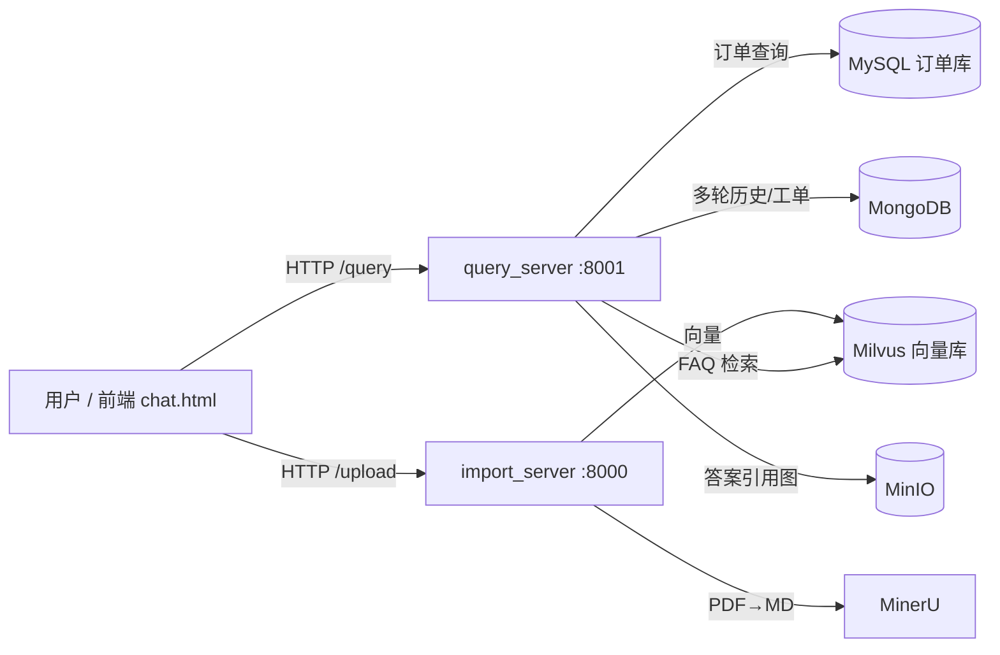
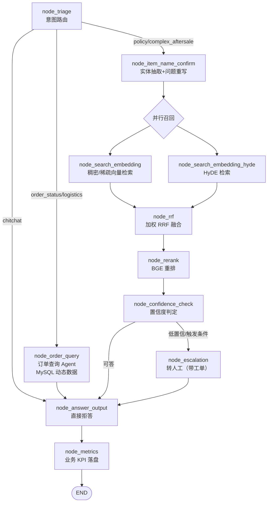

# 电商售后智能客服系统（多 Agent）


> 基于 LangGraph 编排的多 Agent 智能客服系统：**Triage 意图路由 + 专才 Agent 分工 + 置信度拒答/转人工 + 业务 KPI 指标体系**，覆盖电商售后「订单查询 / 物流 / 退换货政策 / 复杂售后」全场景。

## 🎯 业务场景

**痛点**：电商售后咨询量大、重复问题占比高（发货时效 / 退换货政策 / 物流进度被反复询问），人工客服成本随服务时间与咨询规模同步增长，且大促期流量波峰难以按峰值配置人力。

**方案**：AI 负责高频标准问题（知识库 FAQ / 订单状态查询），复杂售后与低置信问题自动转人工（携带完整上下文）。**业务验收线**：

| 指标 | 目标 | 实测（25 会话冒烟） |
|------|------|--------|
| 转人工率 | ≤ 30% | **12.0%** ✅ |
| AI 独立解决率 | ≥ 70% | **88.0%** ✅ |
| 首响时间 FRT P95 | < 2s | **726ms** ✅ |
| 意图路由准确率 | ≥ 85% | **90%**（50 条评估集）✅ |
| 拒答正确率 | 100% 不硬答 | 知识库外问题 3/3 转人工 ✅ |

> **演示数据声明**：本仓库为演示环境，业务数据（订单库 / FAQ 知识库 / 评估集）均为**模拟数据**（README 已声明）；数据管线按生产量级设计（Milvus 批量导入 / 增量更新 / 切片策略），替换真实业务数据源（MySQL 订单库、真实 FAQ 文档）即可直接运行。这是企业应用演示的标准做法（OpenAI 官方客服 demo 同为 mock 数据）。

---

## ✨ 核心特性

### 客服业务层
- **Triage 意图路由**：LLM 5 类意图分类（订单状态 / 物流 / 政策 / 复杂售后 / 闲聊），低置信兜底 + chitchat 直接拒答（guardrails）。
- **订单查询 Agent**：动态业务数据走 MySQL 订单库（API），与 RAG 静态知识分离——避免"动态数据进知识库导致过期"。
- **置信度拒答 / 转人工**：5 种触发条件（用户要求人工 / 检索为空 / 重排分数低 / 多轮未解决 / 涉及赔付），工单携带完整上下文落库（`escalation_tickets`）。
- **业务 KPI 体系**：转人工率 / AI 独立解决率 / 首响时间（TTFT）自动落盘，`scripts/report_kpi.py` 一键出周报。
- **知识更新闭环**：转人工（未命中）问题自动记录 → 聚类复盘 → 补 FAQ → 重跑评估。

### 底层检索/工程（RAG 底座）
- **双图编排（LangGraph）**：导入图 + 查询图，状态在节点间流转。
- **混合检索**：BGE-M3 双向量（稠密 `HNSW+COSINE` / 稀疏 `SPARSE_INVERTED_INDEX+IP`）并行召回。
- **HyDE 增强 + 加权 RRF 融合 + BGE 重排**：多路召回统一融合、交叉编码器精排、动态 TopK。
- **SSE 流式**：节点级进度可视化 + 逐字生成，首字延迟 ~507ms。
- **LLM 调用可观测**：每次调用记录耗时 + token 用量（`llm_metrics.jsonl`）。
- **多轮记忆**：MongoDB 会话历史，支持上下文连续追问。
- **可评估**：RAGAS 评估（54 条）+ 客服评估集（50 条 5 类意图）+ 冒烟测试。

---

## 🏗️ 技术架构

### 系统总览



### 查询流水线（Query Graph）



> **封闭知识域设计**：客服 FAQ 链路**禁用联网检索**（`node_web_search_mcp`）——实测"分期付款"会被联网搜成银行知识（rerank 0.527）导致 LLM 基于域外信息编造答案。企业知识库是封闭域，答案必须只来自知识库。

---

## 🧰 技术栈

| 层 | 技术 |
|----|------|
| 编排 | LangGraph 1.2.x（Triage + 专才 Agent + 条件路由） |
| LLM | OpenAI 兼容接口（`LLM_DEFAULT_MODEL`，如 qwen-flash） |
| 嵌入 / 重排 | BGE-M3（稠密+稀疏双向量）、BGE 交叉编码器重排 |
| 向量库 | Milvus，稠密 `HNSW+COSINE` / 稀疏 `SPARSE_INVERTED_INDEX+IP` |
| 业务库 | MySQL（订单库 `order_service`，动态数据走 API） |
| 文档解析 | MinerU（`magic-pdf`） |
| 对象存储 | MinIO（文档配图） |
| 对话历史 / 工单 | MongoDB（`chat_message` / `escalation_tickets`） |
| 评估 | RAGAS 0.2.15 + 客服评估集 + KPI 周报 |
| API / 流式 | FastAPI + SSE（`EventSource`） |
| 运行时 | Python ≥ 3.12 |

---

## 🚀 快速开始

### 前置依赖
- Python ≥ 3.12
- 已部署的 Milvus、MongoDB、MySQL（订单库）、MinIO
- 可用的 LLM API（OpenAI 兼容）、MinerU API

### 1. 安装依赖
```bash
uv sync
# 或：pip install -e .
```

### 2. 配置环境变量
```bash
cp .env.example .env   # 填入 API Key、数据库地址等
```
关键变量：`MILVUS_URL` / `MONGO_URL` / `MYSQL_HOST` `MYSQL_PASSWORD` `MYSQL_DB` / `OPENAI_API_KEY` 等。

### 3. 初始化数据（三件套）
```bash
# 3.1 订单库：执行 data/mock_orders.sql 建表灌数据（或 python scripts/gen_mock_orders.py 造数）
# 3.2 FAQ 知识库灌入 Milvus
python scripts/import_faq.py
# 3.3 评估/冒烟
python scripts/eval_intent.py        # 意图路由准确率
python scripts/eval_cs_smoke.py      # 冒烟 25 会话生成 KPI
python scripts/report_kpi.py         # KPI 周报
```

### 4. 启动服务（两个终端）
```bash
python -m app.import_process.api.import_server   # 导入服务 :8000
python -m app.query_process.api.query_server     # 查询服务 :8001
```
浏览器访问 `http://127.0.0.1:8001/chat.html`

---

## 📊 评估指标（真实运行）

### 客服业务指标（25 会话冒烟，`scripts/report_kpi.py`）

| 指标 | 实测 | 验收线 | 结果 |
|------|------|--------|------|
| 转人工率 | 12.0%（3/25） | ≤ 30% | ✅ |
| AI 独立解决率 | 88.0% | ≥ 70% | ✅ |
| 首响时间 FRT P95 | 726ms | < 2s | ✅ |
| 意图路由准确率 | 90%（45/50） | ≥ 85% | ✅ |

按意图维度：`complex_aftersale` 转人工率 66.7%（复杂售后该转就转，预期正确行为）、`policy` 25%、`order_status`/`logistics`/`chitchat` 0%。

### 检索质量指标（RAGAS，54 条技术文档问答）

| 指标 | 实测值 |
|------|--------|
| faithfulness（忠实度） | `0.886` |
| answer_relevancy（答案相关性） | `0.830` |
| context_precision（上下文精确度） | `0.917` |
| context_recall（上下文召回率） | `0.971` |
| 平均首字延迟（TTFT） | `~507 ms` |

> 两套指标分工：RAGAS 证明**检索质量**（技术指标），KPI 证明**业务价值**（业务指标）——转人工率 / 解决率才是公司验收系统的口径。

---

## 📁 项目结构

```
app/
├── clients/            # 外部服务客户端（Milvus / MinIO / MySQL）
├── conf/               # 配置（milvus / mongo / mysql / lm）
├── core/               # 日志、Prompt 加载等基础设施
├── eval/               # 评估（ragas_eval / cs_eval_set.json / kpi_metrics.jsonl / ttft_metrics.jsonl）
├── import_process/     # 导入服务：api / agent(导入图) / page
├── lm/                 # LLM 客户端封装（含 invoke_llm_with_metrics 可观测）
├── query_process/      # 查询服务：agent(查询图：triage/order_query/confidence/escalation/metrics)
├── tool/               # 工具
└── utils/              # 任务状态、SSE 队列等工具
data/                   # 模拟业务数据（mock_orders.sql / faq 知识库）
doc/                    # 原始文档（不入库）
prompts/                # Prompt 模板（triage_intent / order_query_answer / answer_out ...）
scripts/                # 数据生成 / 灌库 / 评估 / KPI 脚本
```

---

## 🐳 容器化部署

```bash
cp .env.example .env
docker compose up -d
```
- 导入服务：http://localhost:8000/import
- 查询服务：http://localhost:8001/chat.html

> 注：MySQL 订单库为客服业务新增依赖，如使用 Docker Compose 部署请在 `docker-compose.yml` 追加 mysql 服务，或使用已部署的 MySQL 实例。

---

## 🗺️ 后续规划

- **检索召回优化**：阈值校准中发现部分 FAQ 有答案但召回分数极低（如"耳机质保多久"= 0.001），下一步调切片策略 / 扩充评估集覆盖。
- **多轮未解决追踪**：把"多轮未解决"从会话历史扩展到工单维度，定位顽固问题。
- **缓存层**：高频问题命中缓存，降低 token 成本（当前单次回答平均 ~69 字符 / 546 tokens）。
- **渠道层预留**：统一消息层设计，支持网页 / 小程序 / 企微多渠道接入（当前以 Web 为演示渠道）。

> 当前版本聚焦「多 Agent 客服编排 + 置信度转人工 + 业务 KPI」的完整落地，已在模拟业务数据上验证全链路，替换真实数据源即可运行。
